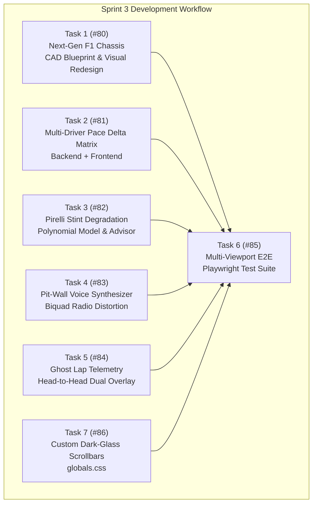

# Sprint 3 Engineering Plan & Product Experience Roadmap

**Document**: `docs/SPRINT-3-PLAN.md`  
**Date**: 2026-11-24  
**Repository**: `529-studio/f1-virtual-engineer`  
**Branch**: `develop`  
**Status**: Approved for Sprint 3 Execution  

---

## 1. User Persona Evaluation & Product Experience Audit

### 1.1 The Core User Personas
1. **The Live Second-Screen Companion Viewer**: Hardcore F1 fan watching live race broadcasts (F1 TV / K+). Demands real-time tactical foresight: predicting tyre degradation cliffs, undercut/overcut success, steward investigation outcomes, and rain arrival cross-over windows before TV commentators notice.
2. **The Sim Racer / Esports Virtual Engineer**: Active competitor in F1 23/24, iRacing, or Assetto Corsa. Analyzes telemetry traces to find lap time deltas, braking references, corner apex speeds, tyre thermal imbalances (camber/pressure optimization), and micro-sector pace splits.
3. **The Pit-Wall Motorsport Data Strategist**: Data enthusiast looking for dense, high-signal, zero-fluff telemetry visualizations (dark-glass HUD, live telemetry charts, mathematical decay models).

---

### 1.2 What The App Has Done Well (Strengths)
- **Genuine Engineering Depth**: Unlike generic F1 fan apps that display shallow lap timing tables, F1 Virtual Engineer simulates real physics:
  - **Thermodynamic Tyre Matrix**: 3-zone lateral surface bands (Inner, Center, Outer) paired with core carcass temperatures, camber bias, and hysteresis gradients.
  - **FIA Sporting Regulations Engine**: Algorithmic track limit breach counts and collision fault probability analysis.
  - **Doppler Weather Radar**: Differential water film accumulation ($dh_w/dt = R - D - E$) and track grip decay ($\mu_{\text{track}}$) driving compound cross-over thresholds.
  - **AI Team Radio Visualizer**: Web Audio API waveform visualization with Whisper transcripts and tactical sentiment tags.
- **Apple/Pit-Wall Design Language**: Adherence to the dark glass telemetry HUD, strict ban on unicode emojis, and WCAG 2.5.5 kiosk ergonomics ($\ge 44\text{px}$ touch targets).

---

### 1.3 What The App Has NOT Achieved / Critical Gaps (Weaknesses)
- **Crude Chassis Model in Thermal Matrix (User Feedback)**:
  - The current central chassis in `IsometricTyreCanvas.tsx` is an over-simplified, flat geometric polygon wireframe. It resembles a rudimentary retro spaceship or schematic drone rather than an aggressive, aerodynamic modern ground-effect Formula 1 car (2022-2026 regulations).
  - *Impact*: Breaks visual immersion. The tyre thermal cards and line graphs look world-class, but the vehicle body connecting them feels like an unpolished placeholder.
- **Absence of Head-to-Head Telemetry Trace Comparison**:
  - Telemetry is currently siloed to single-driver sessions. Users cannot directly overlay two drivers' qualifying laps (Ghost Lap) to compare throttle, braking, and time delta curves corner-by-corner.
- **Lack of Multi-Driver Sector Pace Delta Matrix**:
  - No dense sector-by-sector delta matrix comparing the active driver to top contenders in real time.
- **Missing Audio Immersion for Pit-Wall Radio**:
  - Radio audio currently plays pre-rendered clips; there is no automated text-to-speech synthesizer reading out pit alerts with realistic biquad radio filter distortion.
- **Static Tyre Life Representation**:
  - Does not yet extrapolate tyre thermal degradation into a dynamic polynomial curve predicting the exact "tyre cliff" lap.
- **Clunky Native Browser Scrollbars (User Feedback)**:
  - Default thick, light-gray browser scrollbars appear on scrollable telemetry panels (e.g., Strategy Pit Window drawer, Race Control feed). This abruptly clashes with the Apple-inspired dark-glass aesthetic.

---

### 1.4 Retention Drivers: What Keeps Users Coming Back
1. **The Tactical Second-Screen Advantage**: Delivering predictive insights 3-5 laps before they happen on television (e.g. "Verstappen tyre cliff in 3 laps", "Rain crossing Inters threshold at Lap 24").
2. **Pit-Wall Immersion & Visual Aesthetics**: Looking like a genuine Mercedes/Red Bull pit-wall telemetry console. An authentic 2026 F1 CAD wireframe or 3D chassis model, paired with bespoke dark-glass scrollbars, transforms the app from a side project into a mission-critical tool.
3. **Post-Session Telemetry Shootout**: Head-to-head ghost lap overlays provide shareable, debate-sparking evidence for motorsport discussions.

---

## 2. Sprint 3 Scope & GitHub Issue Ledger

| Issue ID | Type | Title | Primary Components / Files |
| :--- | :--- | :---- | :------------------------- |
| **#80** | Feature | **Modern Next-Gen F1 Chassis Visual Redesign** | `frontend/src/components/mission-control/IsometricTyreCanvas.tsx`, `F1ChassisBlueprint.tsx` |
| **#81** | Feature | **Multi-Driver Pace Delta Matrix & Real-Time Sector Split Engine** | `backend/app/schemas/pace_delta.py`, `backend/app/routers/pace.py`, `backend/tools/pace_delta.py`, `frontend/src/components/mission-control/PaceDeltaMatrix.tsx` |
| **#82** | Feature | **Pirelli Tyre Degradation Polynomial Model & Stint Cliff Advisor** | `backend/tools/tyre_degradation_model.py`, `backend/app/routers/strategy.py`, `frontend/src/components/mission-control/StintCliffAdvisor.tsx` |
| **#83** | Feature | **Hands-Free Pit-Wall Voice Synthesizer with Realistic Radio Distortion** | `frontend/src/components/mission-control/VoicePitWallAudio.tsx`, `frontend/src/services/pitWallAudio.ts` |
| **#84** | Feature | **Head-to-Head Ghost Lap Telemetry Trace Overlay Canvas** | `frontend/src/components/telemetry/GhostLapOverlay.tsx`, `backend/tools/telemetry_sync.py` |
| **#85** | Testing | **Multi-Viewport End-to-End Playwright Test Suite for Sprint S3 Features** | `frontend/e2e/s3-features.spec.ts` |
| **#86** | UI/UX | **Custom Dark-Glass Pit-Wall Scrollbars (Replace Native Gray Scrollbars)** | `frontend/src/app/globals.css` |

---

## 3. Detailed Technical Specifications

### 3.1 Task S3-T1 (Issue #80): Next-Gen F1 Chassis Visual Redesign
- **Design Paradigms to Implement**:
  - **Aesthetic Direction**: High-Tech Minimalist CAD Blueprint with option for interactive 3D perspective.
  - **Anatomical Accuracy (2022-2026 Ground Effect Specs)**:
    - Accurate front wing endplates with curved outwash dive planes.
    - Sculpted sidepods with deep undercuts and aerodynamic venturi tunnel floor edges.
    - Realistic Halo structure with aerodynamic fairing and central titanium pylon.
    - Cockpit headrest, driver helmet silhouette, and rollover airbox intake.
    - Engine cover shark fin tapering into low-drag beam wing and DRS main plane.
    - Accurate multi-link push-rod/pull-rod suspension wishbones anchored to wheel hubs.
  - **Visual Treatment**: Vector blueprint with cyan/emerald engineering accent lines (`strokeWidth={1.2}`), subtle glow, and aerodynamic flow stream guides.

### 3.2 Task S3-T2 (Issue #81): Multi-Driver Pace Delta Matrix
- **Backend (`backend/app/schemas/pace_delta.py` & `backend/tools/pace_delta.py`)**:
  - Calculate split deltas across Micro-Sectors (S1, S2, S3) and mini-sectors relative to leader or selected benchmark driver.
  - Returns delta status (`faster`, `slower`, `personal_best`, `session_best`).
- **Frontend (`frontend/src/components/mission-control/PaceDeltaMatrix.tsx`)**:
  - Apple dark-glass table layout with color-coded delta chips:
    - Purple: Session Fastest
    - Green: Personal Best / Ahead
    - Yellow: Neutral ($\pm 0.050\text{s}$)
    - Red: Time Lost ($> +0.100\text{s}$)
  - Responsive kiosk controls ($\ge 44\text{px}$) for selecting reference benchmark driver.

### 3.3 Task S3-T3 (Issue #82): Pirelli Stint Degradation & Cliff Advisor
- **Thermodynamic Model (`backend/tools/tyre_degradation_model.py`)**:
  - Polynomial fit: $\Delta t_{\text{deg}}(L) = a \cdot L^2 + b \cdot L + c$, combined with tyre thermal stress multiplier.
  - Projects "Tyre Cliff Lap" where degradation exceeds $0.25\text{s/lap}$.
  - Generates recommended Pit Box Window (undercut lap range vs overcut lap range).
- **Frontend Widget (`frontend/src/components/mission-control/StintCliffAdvisor.tsx`)**:
  - Interactive SVG degradation curve showing current lap on stint trajectory.
  - Warning badge when approaching tyre cliff ($\le 3$ laps).

### 3.4 Task S3-T4 (Issue #83): Pit-Wall Voice Synthesizer with Biquad Radio Filter
- **Audio Engine (`frontend/src/services/pitWallAudio.ts`)**:
  - Web Speech API speech synthesis engine for hands-free audio announcements.
  - Web Audio API graph:
    - `AudioContext` $\to$ `BiquadFilterNode` (Bandpass: frequency $1200\text{Hz}$, Q $2.5$) $\to$ `WaveShaperNode` (subtle harmonic distortion) $\to$ `GainNode`.
  - Realistic mic squelch / static burst at transmission start and end.
- **UI (`frontend/src/components/mission-control/VoicePitWallAudio.tsx`)**:
  - Audio mute/unmute toggle, volume slider, and transmission activity indicator.

### 3.5 Task S3-T5 (Issue #84): Head-to-Head Ghost Lap Telemetry Trace Overlay
- **Telemetry Sync (`frontend/src/components/telemetry/GhostLapOverlay.tsx`)**:
  - Synchronized dual-driver traces over track distance ($x \in [0, D_{\text{lap}}]$):
    - Speed ($\text{km/h}$)
    - Throttle ($\%$) & Brake ($\text{bar}$)
    - Gear & DRS status
    - Cumulative Time Delta: $\Delta t(x) = t_{\text{driver1}}(x) - t_{\text{driver2}}(x)$
  - 60fps distance scrubber driven by `requestAnimationFrame`.

### 3.6 Task S3-T6 (Issue #85): Multi-Viewport End-to-End Playwright Test Suite
- Comprehensive validation suite in `frontend/e2e/s3-features.spec.ts`:
  - **Desktop (1440x900)**: Full telemetry grid layout and dual-trace ghost lap synchronization.
  - **Tablet (834x1112)**: Split layout and touch scrubbing responsiveness.
  - **Mobile (390x844)**: Compact card stacking, zero horizontal overflow (`scrollWidth === clientWidth`), touch targets $\ge 44\text{px}$.

### 3.7 Task S3-T7 (Issue #86): Custom Dark-Glass Pit-Wall Scrollbars
- **Global Scrollbar Refinement (`frontend/src/app/globals.css`)**:
  - Replace default gray operating system scrollbars with ultra-sleek, dark-glass pit-wall scrollbars.
  - Standards-compliant CSS properties: `scrollbar-width: thin; scrollbar-color: rgba(255, 255, 255, 0.15) transparent;`.
  - WebKit custom selectors:
    - `::-webkit-scrollbar`: 6px width.
    - `::-webkit-scrollbar-track`: subtle background or transparent.
    - `::-webkit-scrollbar-thumb`: `rgba(255, 255, 255, 0.15)` with `rounded-full`.
    - `::-webkit-scrollbar-thumb:hover`: `rgba(56, 189, 248, 0.35)` telemetry cyan tint.
  - Applied globally to `html`, `body`, and all scrollable panels/drawers.

---

## 4. Execution Sequence & Sprint Backlog

---

## 5. Definition of Done Checklist
- [ ] All 7 GitHub issues (#80 to #86) addressed with dedicated branch flow (`feature/*`).
- [ ] Strict adherence to the 4-file pattern: DTO -> Service -> Hook -> Component.
- [ ] Zero unicode emojis across all new components and telemetry badges.
- [ ] All interactive touch targets strictly $\ge 44\text{px} \times 44\text{px}$.
- [ ] Empirical E2E testing passing across Desktop (1440x900), Tablet (834x1112), and Mobile (390x844) with zero console errors.
